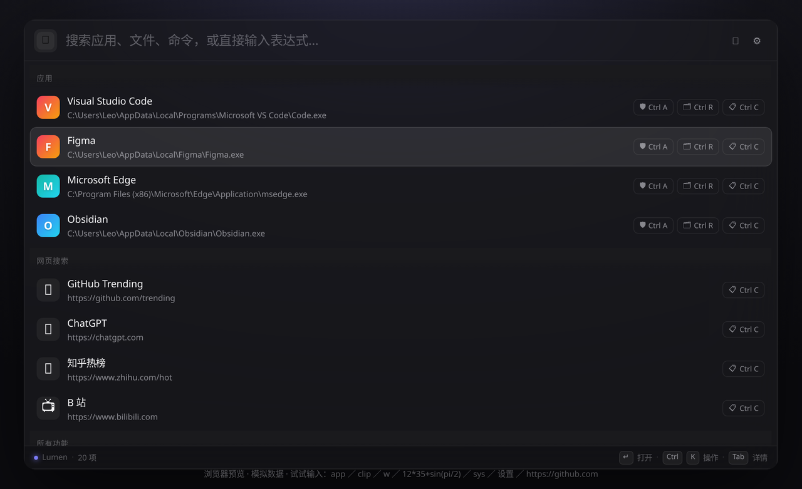
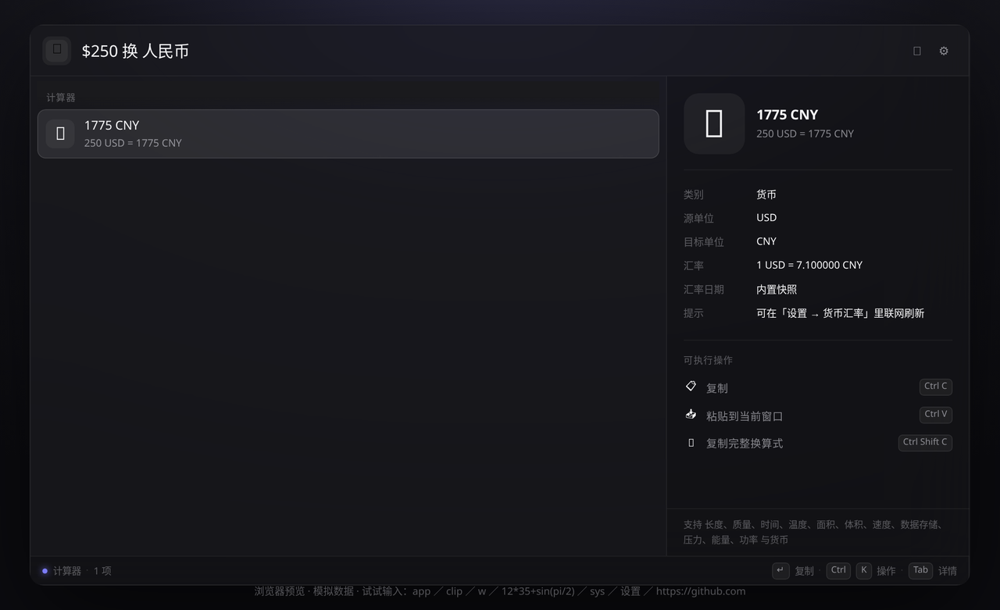
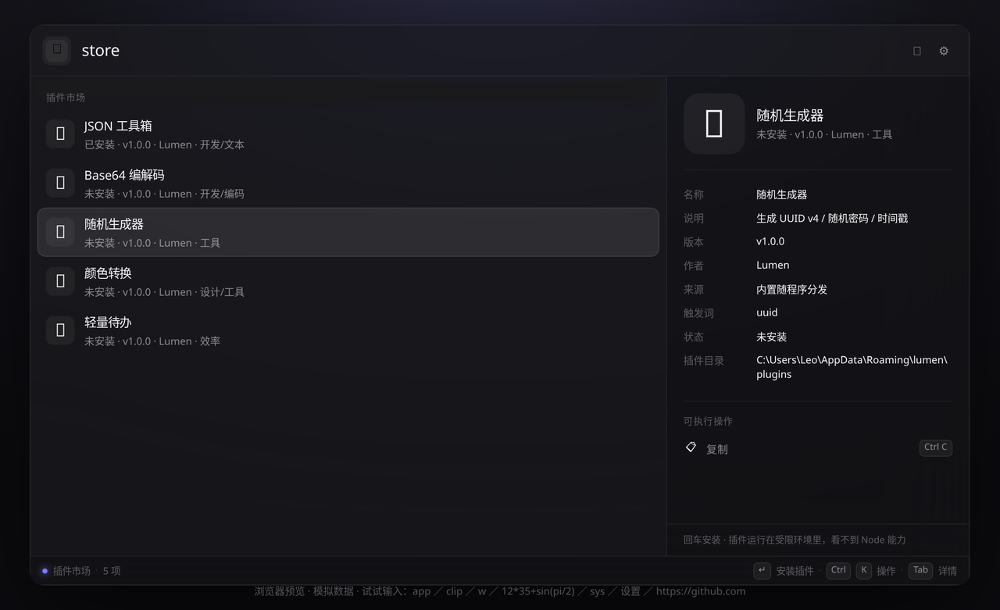
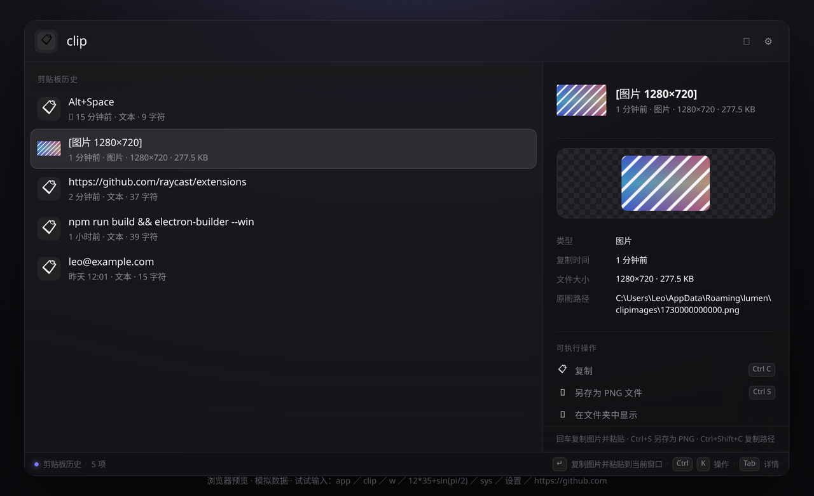
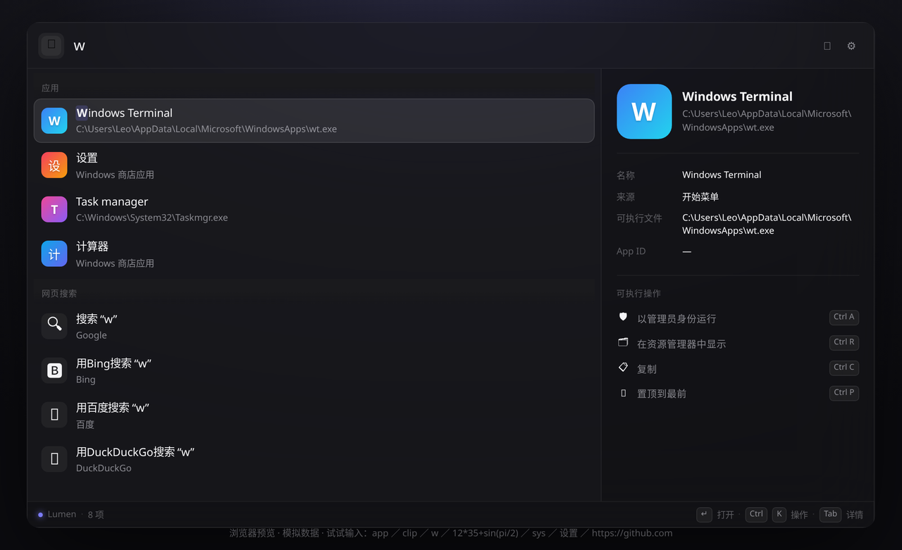

<div align="center">


# Lumen

**一款为 Windows 打造的 Raycast 风格生产力启动器**

Electron 38 · React 19 · TypeScript · 零 native 依赖

[在线体验 →](https://<your-username>.github.io/lumen/) · [下载发行版 →](https://github.com/<your-username>/lumen/releases)

</div>



---

## ✨ 功能总览

| 功能 | 触发方式 | 说明 |
|---|---|---|
| 🚀 应用启动 | 直接输入 / `app` | 扫描开始菜单 + 注册表 + UWP，真实系统图标，支持管理员运行 |
| 🧮 计算器 | 直接输入表达式 / `=` | Shunting-yard 求值，支持 `sin/cos/sqrt/log/!` 等，附带进制与千分位 |
| 🔄 单位/货币换算 | 直接输入，如 `100km to mi` | 11 类物理单位 + 22 种货币，支持中文写法（`$250 换 人民币`、`3尺是多少厘米`、`1GB=?MB`） |
| 🧠 智能排序 | 自动 | 记录使用频率与最近使用时间，越常用的结果排得越靠前，可手动置顶 |
| 📂 文件搜索 | `f 关键词` | 内置增量索引（可配 Everything es.exe 秒级全盘搜索） |
| 🌐 网页搜索 | `s 关键词` / 直接输网址 | Google / Bing / 百度 / DuckDuckGo 可切换 |
| 📋 剪贴板历史 | `clip` | 文本 / **图片** / 文件通吃：图片显示缩略图与大图预览，支持另存为 PNG |
| 🧩 插件市场 | `store` | 一键安装 / 卸载 / 启停第三方扩展，内置 5 个开箱即用的插件，支持自定义市场索引 |
| 🪟 窗口切换 | `w 关键词` | 枚举所有可见窗口，可靠置前；每条结果带 **左/右半屏、最大化、居中、跨屏移动** 动作 |
| 🔌 端口占用 | `port 3000` | netstat 解析端口占用，直接看到进程并一键结束 |
| ⚙️ 进程管理 | `kill 名字` | 按内存排序列出进程，模糊过滤后一键强制结束 |
| 📶 Wi-Fi 列表 | `wifi` | 附近无线网络 + 信号强度 + 认证方式，标记当前连接 |
| ⚡ 系统命令 | `sys` | 锁屏 / 睡眠 / 休眠 / 关机 / 重启 / 清空回收站 / 公网 IP |
| 🧩 自定义命令 | `ext` | 编辑 `commands.json` 即可扩展，无需写代码 |
| 🔗 快捷搜索 | `ql` | 站内搜索模板（GitHub/MDN/B站…），`gh react` 一键定向，URL 模板 `{query}`/`{Query}` 可自由新增 |
| ✏️ 文本片段 | `snip` | 常用文本带占位符：`{clipboard}` `{date}` `{time}` `{arg}` `{cursor}`，回车即粘贴到当前窗口 |
| 😀 Emoji 搜索 | `emoji` | 1898 个 Emoji 离线数据，中文/英文/拼音都能搜，回车即粘贴 |
| 🔖 浏览器书签 | `bm` | 读取 Chrome / Edge / Brave 本地收藏夹，模糊搜索直达网址 |
| ✨ AI 助手 | `ai 提问` | OpenAI 兼容接口（默认 DeepSeek），答案直接显示在详情面板 |
| ⚙️ 设置 | `settings` 或 `Ctrl+,` | 全部设置表单化编辑（下拉/开关/数字/密码框），不用手改 JSON |

## 📸 界面一览

<table>
<tr>
<td></td>
<td></td>
</tr>
<tr>
<td></td>
<td></td>
</tr>
</table>

> 以上截图均取自 `docs/index.html` —— 仓库自带的单文件浏览器预览，无需安装即可把玩全部交互逻辑。

## ⌨️ 快捷键

| 按键 | 作用 |
|---|---|
| `Alt+Space`（可改） | 全局唤起 / 隐藏 |
| `↑` `↓` / `Ctrl+N` `Ctrl+P` | 选择结果 |
| `Enter` | 执行主操作 |
| `Ctrl+1..9` | 执行第 N 个操作 |
| `Ctrl+K` | 打开动作面板（Action Panel） |
| `Tab` / `Ctrl+D` | 展开右侧详情面板 |
| `Ctrl+I` | AI 助手 |
| `Ctrl+,` | 设置 |
| `Esc` | 清空输入 → 返回上级 → 隐藏窗口 |

## 🏃 快速开始

```bash
npm install          # 安装依赖
npm run dev          # 开发模式（热更新）
npm run build        # 构建产物
npm run dist:win     # 打包 Windows 安装包（NSIS + 便携版）
```

> 构建安装包需要在 Windows 上执行（electron-builder 不支持在 Linux 交叉打包 NSIS）。
> 产物输出到 `dist/Lumen-Setup-x.y.z.exe` 与 `Lumen-x.y.z-portable.exe`。

## 🏗️ 架构

```
src/
├─ main/                     # Electron 主进程
│  ├─ index.ts               # 生命周期 / 全局热键 / 单例锁
│  ├─ window.ts              # 无边框毛玻璃窗口 / 托盘 / 尺寸自适应
│  ├─ ipc.ts                 # 全部 IPC handler
│  ├─ store.ts               # settings.json 持久化
│  ├─ util/powershell.ts     # PowerShell 执行器（UTF-8 编码修正）
│  └─ services/
│     ├─ applications.ts     # 开始菜单 + 注册表 + UWP 应用扫描
│     ├─ files.ts            # 文件索引 / Everything 接入
│     ├─ clipboard.ts        # 剪贴板历史（文本 + 图片）
│     ├─ windows.ts          # 窗口枚举 / 激活（user32 P/Invoke）
│     ├─ system.ts           # 系统级命令
│     └─ commands.ts         # 用户自定义命令加载
├─ preload/index.ts          # contextBridge 安全桥接
├─ shared/types.ts           # 三端共享类型契约
└─ renderer/                 # React UI
   ├─ engine/
   │  ├─ registry.ts         # 扩展注册与触发词解析
   │  ├─ fuzzy.ts            # 模糊匹配（支持拼音首字母）
   │  ├─ calc.ts             # 表达式求值器
   │  └─ providers/          # 每个功能一个 Provider
   ├─ hooks/useLumen.ts      # 核心状态机（导航栈 / 搜索 / 动作）
   └─ components/            # UI 组件
```

**设计要点**

- 主进程只做系统交互（扫描、索引、执行），Provider 逻辑全部跑在渲染进程 —— 与 Raycast 的扩展架构一致，加新功能只需新增一个 provider 文件并注册进 `registry.ts`。
- 所有系统调用通过 PowerShell + user32 P/Invoke 完成，**没有任何 native addon**，构建零编译依赖。
- 渲染层自带 mock 层（`renderer/mock.ts`）：无 Electron 环境时自动降级，可直接在浏览器里开发调试 UI。

## 🧩 添加自定义命令

编辑 `%APPDATA%/lumen/commands.json`：

```json
[
  { "name": "打开 Cursor", "keyword": "cur", "type": "open", "target": "C:\\...\\Cursor.exe", "icon": "🖥️" },
  { "name": "重启构建服务", "keyword": "build", "type": "shell", "target": "npm run build", "cwd": "D:\\proj", "icon": "🔨" },
  { "name": "快速粘贴邮箱", "keyword": "mail", "type": "snippet", "target": "me@example.com", "icon": "✉️" },
  { "name": "GitHub Trending", "keyword": "gh", "type": "url", "target": "https://github.com/trending", "icon": "🌐" }
]
```

保存后在设置里点「重新加载命令文件」即可生效。

## 🛍️ 插件开发

插件 = 一个目录（`plugin.json` + 入口 JS），放在 `%APPDATA%/lumen/plugins/<id>/`，启动时自动加载。写完也可以放进市场分享：把目录提交到市场索引指向的仓库即可。

**plugin.json**

```json
{
  "id": "my-plugin",
  "name": "我的插件",
  "version": "1.0.0",
  "author": "你",
  "description": "一句话说明",
  "icon": "🧩",
  "aliases": ["my", "我的"],
  "participatesInRoot": false,
  "rank": 60,
  "main": "index.js"
}
```

**index.js**（CommonJS，导出 `search`）

```js
module.exports = {
  icon: '🧩',
  async search(ctx) {
    // ctx.args 触发词后的输入；ctx.api 系统能力；ctx.toast 提示；ctx.close 关窗；ctx.refresh 刷新
    return [
      {
        id: 'demo',
        title: `你好，${ctx.args || '世界'}`,
        subtitle: '插件返回的第一条结果',
        icon: '👋',
        actions: [{ id: 'copy', name: '复制', icon: '📋', run: () => ctx.api.clipboard.write(ctx.args) }]
      }
    ]
  }
}
```

插件运行在**受限环境**：拿不到 Node / 文件系统，只能通过 `ctx.api` 访问 Lumen 提供的能力；持久化用 `ctx.api.storage.get/set`（落在 `plugin-store.json`）。`resources/plugins/` 下有 5 个完整示例（JSON 工具箱、Base64、随机生成器、颜色转换、轻量待办）。

## 🔧 常见问题

- **Alt+Space 被占用？** 主进程会自动降级尝试 `Ctrl+Space` 等候选组合，也可在设置里手动挑选。
- **想要全盘毫秒级文件搜索？** 安装 [Everything](https://www.voidtools.com/) 并把 `es.exe` 路径填进设置，文件搜索会自动切换到 Everything。
- **Windows 10 没有毛玻璃？** 窗口使用 Windows 11 的 Acrylic 材质，Win10 自动回落到半透明 + 渲染层模糊。
- **AI 不工作？** 在设置里启用 AI 并填入 API Key（任何 OpenAI 兼容接口均可，如 DeepSeek）。

## 📄 License

MIT
