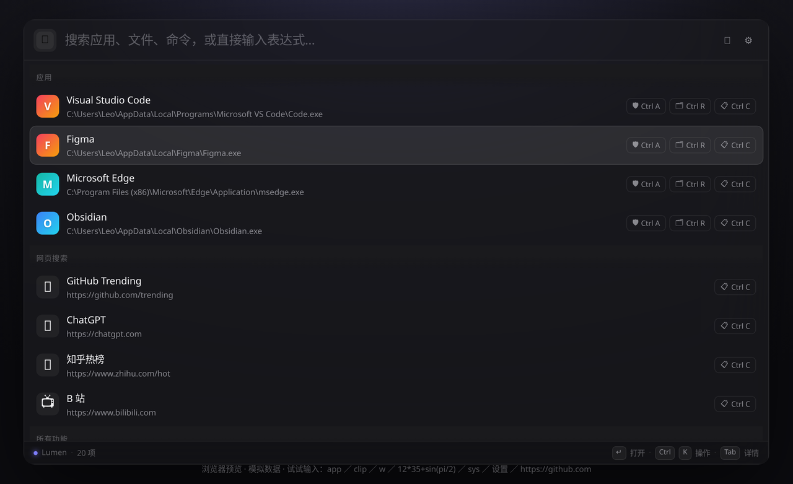
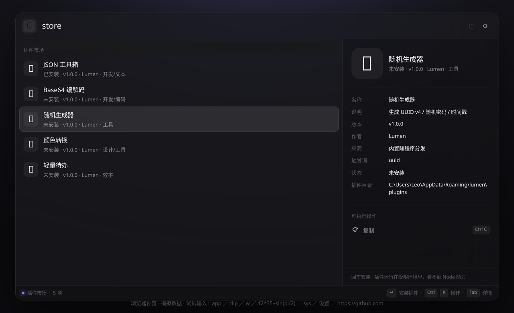

# Lumen v1.0.0

> 一款为 Windows 打造的 Raycast 风格生产力启动器。Electron 38 · React 19 · TypeScript · **零 native 依赖**。

这是 Lumen 的首个正式版本。按 **Alt+Space** 唤起，一个输入框搞定：启动应用、搜文件、算数、换算单位、翻剪贴板、窗口分屏、查端口占用、装插件。



## ✨ 这一版的亮点

- **🧠 智能排序** —— 用得越多排得越靠前，还能手动置顶常用项
- **⚙️ 全部设置可视化** —— 下拉框 / 开关 / 数字框 / 密码框，不用手改 JSON
- **🛍️ 插件市场** —— `store` 一键安装卸载，内置 5 个开箱即用的插件，也支持第三方扩展
- **🖼️ 剪贴板支持图片** —— 缩略图 + 大图预览 + 另存为 PNG
- **🪟 窗口分屏** —— 左/右半屏、最大化、居中、跨显示器移动
- **📦 零 native 依赖** —— 所有系统调用走 PowerShell + user32 P/Invoke，克隆下来 `npm i` 就能跑，不需要 VS 生成工具



## 📦 下载哪个

| 文件 | 适合 | 说明 |
|---|---|---|
| `Lumen-Setup-1.0.0.exe` | 大多数用户 | NSIS 安装包，可自选安装位置，带开始菜单快捷方式与卸载入口 |
| `Lumen-1.0.0-portable.exe` | 想随身带 | 便携版，不写注册表，丢 U 盘直接双击 |

校验文件（可选）：

```powershell
certutil -hashfile Lumen-Setup-1.0.0.exe SHA256
```

> Windows SmartScreen 可能会提示「未知发布者」——这是因为安装包还没做代码签名证书，点「更多信息 → 仍要运行」即可。

## 🚀 30 秒上手

1. 装完按 **Alt+Space** 唤起（被占用会自动降级到 Ctrl+Space 等候选，也能在设置里改）
2. 直接输应用名 → 回车启动
3. 输入 `2+3*4`、`100km to mi`、`$250 换 人民币` → 实时出结果，直接复制
4. 输入 `store` → 逛插件市场，装个 JSON 工具箱试试
5. `Ctrl+,` 进设置，**`Tab`** 开右侧详情面板

## 🧩 内置功能一览

| 功能 | 触发方式 | 说明 |
|---|---|---|
| 🚀 应用启动 | 直接输入 / `app` | 开始菜单 + 注册表 + UWP，真实系统图标，支持管理员运行 |
| 🧮 计算器 | 直接输入表达式 / `=` | Shunting-yard 求值，支持 `sin/cos/sqrt/log/!` |
| 🔄 单位/货币换算 | 如 `100km to mi` | 11 类物理单位 + 22 种货币，支持 `$250 换 人民币` 这类中文写法 |
| 🧠 智能排序 | 自动 | 频率 + 新近度加权，可手动置顶 |
| 📂 文件搜索 | `f 关键词` | 内置增量索引，可配 Everything 全盘秒搜 |
| 🌐 网页搜索 | `s 关键词` | Google / Bing / 百度 / DuckDuckGo |
| 📋 剪贴板历史 | `clip` | 文本 / 图片 / 文件，图片带缩略图，支持另存为 PNG |
| 🪟 窗口切换 | `w 关键词` | 可靠置前；每条结果带半屏 / 最大化 / 居中 / 跨屏动作 |
| 🔌 端口占用 | `port 3000` | netstat 解析，看到进程并可一键结束 |
| ⚙️ 进程管理 | `kill 名字` | 按内存排序，模糊过滤，一键强杀 |
| 📶 Wi-Fi 列表 | `wifi` | 附近网络 + 信号强度 + 认证方式 |
| ⚡ 系统命令 | `sys` | 锁屏 / 睡眠 / 休眠 / 关机 / 重启 / 清空回收站 / 公网 IP |
| 🧩 自定义命令 | `ext` | 编辑 `commands.json` 扩展，无需写代码 |
| 🛍️ 插件市场 | `store` | 安装 / 卸载 / 启停第三方扩展 |
| 🔗 快捷搜索 | `ql` | 站内搜索模板，`gh react` 一键直达 |
| ✏️ 文本片段 | `snip` | `{clipboard}` `{date}` `{arg}` `{cursor}` 等占位符 |
| 😀 Emoji 搜索 | `emoji` | 1898 个 Emoji 离线数据，中英文都能搜 |
| 🔖 浏览器书签 | `bm` | Chrome / Edge / Brave 收藏夹模糊搜索 |
| ✨ AI 助手 | `ai 提问` | OpenAI 兼容接口（默认 DeepSeek） |
| ⚙️ 设置 | `settings` / `Ctrl+,` | 全部表单化编辑 |

## 🔧 系统要求

- Windows 10 1809 及以上（推荐 Windows 11）
- **毛玻璃材质需要 Windows 11**，Win10 自动回落到半透明 + 渲染层模糊
- 无需预装任何运行时，Electron 已打包在内

## ⚠️ 已知限制

- 关机 / 休眠、结束系统进程这类操作可能触发 UAC
- 剪贴板历史采用 600ms 轮询（为了零 native 依赖），极少数场景有 <1s 延迟
- 文件搜索默认只索引用户目录；要全盘秒搜需装 [Everything](https://www.voidtools.com/) 并在设置里填 `es.exe` 路径
- 端口 / 进程 / Wi-Fi 依赖系统命令输出，非中文系统下个别字段会显示英文
- 安装包未经代码签名，首次运行会有 SmartScreen 提示

## 🔜 下一步

- 官方插件索引上线（现已支持自定义索引 URL）
- 主题自定义 CSS
- 多语言界面

## 📄 License

MIT © 2026 Lumen

---

<br>

# Lumen v1.0.0 (English)

> A Raycast-style productivity launcher for Windows. Electron 38 · React 19 · TypeScript · **zero native dependencies**.

First stable release. Hit **Alt+Space**, and one input box handles it all: launching apps, finding files, doing math, converting units, browsing clipboard history, snapping windows, inspecting ports and installing plugins.


## ✨ Highlights

- **🧠 Adaptive ranking** — the more you use something, the higher it ranks; pin anything manually
- **⚙️ Fully visual settings** — dropdowns, toggles, number and password fields. No JSON editing
- **🛍️ Plugin store** — `store` to install or remove extensions; 5 plugins ship in the box, third-party ones supported
- **🖼️ Clipboard handles images** — thumbnails, full previews and "save as PNG"
- **🪟 Window snapping** — left/right half, maximize, center, move to next display
- **📦 Zero native deps** — every system call goes through PowerShell + user32 P/Invoke, so `npm i` is all you need (no Visual Studio build tools)


## 📦 Which file to download

| File | For | Notes |
|---|---|---|
| `Lumen-Setup-1.0.0.exe` | Most users | NSIS installer, custom install path, Start Menu shortcut and clean uninstall |
| `Lumen-1.0.0-portable.exe` | On the go | Portable build, writes nothing to the registry, run straight from a USB drive |

Verify the download (optional):

```powershell
certutil -hashfile Lumen-Setup-1.0.0.exe SHA256
```

> Windows SmartScreen may say "unknown publisher" — the binaries are not code-signed yet. Choose **More info → Run anyway**.

## 🚀 30-second quick start

1. Press **Alt+Space** (if it's taken, Lumen falls back to Ctrl+Space and others; change it in Settings)
2. Type an app name → Enter to launch
3. Type `2+3*4`, `100km to mi` or `$250 换 人民币` → instant result, ready to copy
4. Type `store` → browse the plugin store and install the JSON toolkit
5. `Ctrl+,` opens Settings, **`Tab`** toggles the detail panel

## 🧩 Built-in features

| Feature | Trigger | Notes |
|---|---|---|
| 🚀 Apps | type directly / `app` | Start Menu + registry + UWP, real system icons, run as admin |
| 🧮 Calculator | expression / `=` | Shunting-yard evaluator with `sin/cos/sqrt/log/!` |
| 🔄 Unit & currency | e.g. `100km to mi` | 11 unit families + 22 currencies, Chinese phrasing supported |
| 🧠 Adaptive ranking | automatic | Frequency + recency weighting, manual pinning |
| 📂 File search | `f <query>` | Built-in incremental index, optional Everything backend |
| 🌐 Web search | `s <query>` | Google / Bing / Baidu / DuckDuckGo |
| 📋 Clipboard history | `clip` | Text, images and files; image thumbnails and save-as-PNG |
| 🪟 Window switcher | `w <query>` | Reliable focus; half-screen, maximize, center and cross-display actions |
| 🔌 Port inspector | `port 3000` | netstat parsing, see the process and kill it |
| ⚙️ Process manager | `kill <name>` | Sorted by memory, fuzzy filter, force kill |
| 📶 Wi-Fi networks | `wifi` | Nearby networks with signal strength and auth type |
| ⚡ System commands | `sys` | Lock / sleep / hibernate / shutdown / restart / empty recycle bin / public IP |
| 🧩 Custom commands | `ext` | Extend via `commands.json`, no code needed |
| 🛍️ Plugin store | `store` | Install, uninstall, enable and disable extensions |
| 🔗 Quicklinks | `ql` | Site search templates — `gh react` jumps straight there |
| ✏️ Snippets | `snip` | Placeholders: `{clipboard}` `{date}` `{arg}` `{cursor}` |
| 😀 Emoji picker | `emoji` | 1,898 emoji offline, searchable in English and Chinese |
| 🔖 Bookmarks | `bm` | Fuzzy search across Chrome / Edge / Brave favorites |
| ✨ AI assistant | `ai <question>` | Any OpenAI-compatible endpoint (DeepSeek by default) |
| ⚙️ Settings | `settings` / `Ctrl+,` | Every option editable through forms |

## 🔧 Requirements

- Windows 10 1809 or later (Windows 11 recommended)
- **The acrylic blur needs Windows 11**; Windows 10 falls back to translucency + renderer-side blur
- No runtime to install — Electron is bundled

## ⚠️ Known limitations

- Shutdown / hibernate and killing system processes may trigger UAC
- Clipboard history polls every 600 ms (keeps native deps at zero); in rare cases you may notice a sub-second delay
- File search indexes your user folder by default; install [Everything](https://www.voidtools.com/) and set the `es.exe` path for instant whole-disk search
- Port / process / Wi-Fi views parse system command output, so a few labels stay English on non-Chinese systems
- Binaries are unsigned, so SmartScreen warns on first run

## 🔜 What's next

- Official plugin index (custom index URLs already work)
- Custom theme CSS
- Multi-language UI

## 📄 License

MIT © 2026 Lumen
